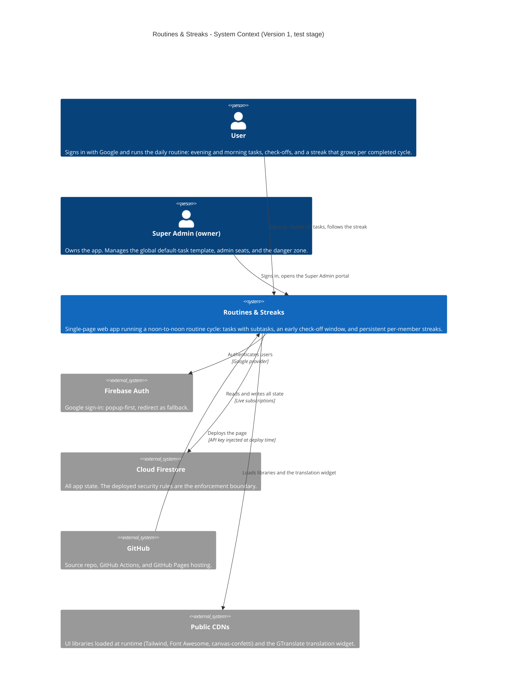

# Routines & Streaks — Architecture

C4-lite diagrams for Routines & Streaks, drawn from the app as it is
today — **Version 1, declared done Oct 29, 2026**: a single-file web
app (`index.html`) on GitHub Pages, Google sign-in via Firebase Auth,
all state in Cloud Firestore, the deploy workflow injecting the
Firebase API key at publish time, and Super Admin identity from the
Firestore `system_admins` registry. The app is in **test stage**: no
production data, and no real names, emails, or identifiers appear
here.

One element is **not** in Version 1: the **Error Reporter**, part of
the proposed fleet-wide error-reporting standard (kit proposal,
repo-template issue #2). It is drawn in the Container and Deployment
views only, named **(PROPOSED)** and shaded grey, so the planned
Phase 1 diagram delta is visible without pretending it exists.

This file is the canonical diagram source: it renders natively on
GitHub, and the interactive page beside it is generated from the
same Mermaid source — there is no second, hand-maintained copy.

**Canonical pattern (v3, adopted Oct 28, 2026):** three views —
System Context (L1), Container (L2), and a Deployment / host view —
with shapes keyed to the kind of thing (see the legend under the
Deployment view) and hosts drawn as their own deployment nodes. An interactive,
draggable rendering of the Deployment view lives beside this file at
[docs/interactive-architecture.html](interactive-architecture.html):
dragging there explores the view and never changes this source.

## Level 1 — System Context

Who uses the app, and which outside systems it touches.

## Level 2 — Container

The whole app is one HTML file, so the containers are the modules
inside it, plus the Firestore collections they use. Shapes are the
native C4 shapes: a **person figure** is a person, a **box** is a
running module, a **cylinder** is a data store, and a **grey system**
is an external service. The Error Reporter and its store are
**PROPOSED** — everything else is Version 1 as shipped.

```mermaid
C4Container
    title Routines & Streaks - Container View (Version 1 + proposed Error Reporter)

    Person(user, "User", "Signed-in user.")
    Person(admin, "Super Admin (owner)", "Owner, via the admin registry.")

    System_Ext(gauth, "Firebase Auth", "Google sign-in (popup-first, redirect fallback).")
    System_Ext(cdn, "Public CDNs", "Tailwind, Font Awesome, canvas-confetti; GTranslate widget.")
    Container_Ext(browser, "Browser Platform", "localStorage first-paint streak cache; Notifications API; clipboard.")

    System_Boundary(app, "Routines & Streaks - index.html, runs in the browser") {

        Container(boot, "Boot and Config", "JavaScript module, in-page", "Loads the Firebase SDK from CDN, initialises the app, subscribes to the global config.")
        Container(auth, "Auth Controller", "JavaScript module, in-page", "Popup-first Google sign-in with a 10-second watchdog and redirect fallback; resolves the session role from the admin registry at sign-in.")
        Container(prov, "Provisioning", "JavaScript module, in-page", "First sign-in only: creates the member profile, starter tasks from the system-defaults template, and the streak doc, in one batch.")
        Container(sync, "Realtime Sync", "JavaScript module, in-page", "Four live Firestore subscriptions (config, tasks, streak, completion history). Noon-cycle rollover reset and the lazy streak reconcile happen here.")
        Container(taskui, "Task UI and Writes", "JavaScript module, in-page - UI screen", "Renders tasks safely (escaped text, one delegated listener). Check-off, add / edit, delete, reorder, subtasks, and the early check-off window.")
        Container(streak, "Streak Engine", "JavaScript module, in-page", "When a cycle completes, one transaction writes the completion proof and updates the streak counters. Idempotent: a cycle can never count twice.")
        Container(portal, "Super Admin Portal", "JavaScript module, in-page - UI screen", "Global overview of members and the audit trail, system-defaults editor, impersonation as an in-place view swap, and the danger zone (delete user, wipe).")
        Container(cross, "Cross-cutting Services", "JavaScript module, in-page", "The visible error banner, the debug console, append-only audit logging, the impersonation guard, and the first-paint streak cache.")
        Container(reporter, "Error Reporter (PROPOSED)", "JavaScript module, in-page - worker", "PROPOSED, not in Version 1: one funnel every failure passes through. Classifies by effect into tiers and hands a minimal report (code, area, recovered-or-not, release) to a pluggable sink.")
    }

    ContainerDb_Ext(members, "Members", "Firestore: families/default/members", "One profile doc per signed-in user, under the single default family.")
    ContainerDb_Ext(tasks, "Tasks", "Firestore: families/default/tasks", "Routine tasks, owner-scoped: each query filters by ownerId.")
    ContainerDb_Ext(streaks, "Streaks and Completions", "Firestore: families/default/streaks + completions", "Streak counters per user, plus one completion-proof doc per finished cycle.")
    ContainerDb_Ext(gconfig, "Global Config", "Firestore: global_config/system_defaults", "The default-task template and the early-buffer setting. Read by provisioning, reset, and the portal.")
    ContainerDb_Ext(admins, "Admin Registry", "Firestore: system_admins", "Super Admin seats, one doc per user ID. Managed only from the Firebase Console or the seed script; the client can read only its own entry.")
    ContainerDb_Ext(audit, "Audit Logs", "Firestore: audit_logs", "Append-only usage trail, written by the app and read in the portal.")
    ContainerDb_Ext(errreports, "Error Reports (PROPOSED)", "Firestore: error_reports", "PROPOSED, not in Version 1: create-only from clients, no public reads. Written by the Error Reporter's Firestore sink.")

    Rel(user, taskui, "Views and checks off tasks")
    Rel(user, auth, "Signs in with Google")
    Rel(admin, portal, "Opens the portal (shield)")
    Rel(boot, gconfig, "Subscribes to the global config")
    Rel(auth, gauth, "Popup sign-in, redirect fallback", "Firebase Auth SDK")
    Rel(auth, admins, "Reads own registry entry to resolve the role")
    Rel(auth, members, "Reads the member profile")
    Rel(prov, members, "Creates the profile (first sign-in)")
    Rel(prov, tasks, "Seeds starter tasks from the template")
    Rel(prov, streaks, "Creates the streak doc")
    Rel(sync, gconfig, "Live subscription")
    Rel(sync, tasks, "Live subscription, owner-scoped query")
    Rel(sync, streaks, "Live subscriptions: streak doc and completion history")
    Rel(taskui, tasks, "Check-off, create, edit, delete, reorder writes")
    Rel(taskui, streak, "Asks for streak evaluation on every toggle")
    Rel(streak, streaks, "One transaction: completion proof + counters")
    Rel(portal, members, "Reads all member profiles")
    Rel(portal, gconfig, "Edits the system-defaults template")
    Rel(portal, audit, "Reads the audit trail")
    Rel(portal, tasks, "Danger zone and reset writes")
    Rel(cross, audit, "Appends audit entries")
    Rel(cross, browser, "Caches the last-seen streak for first paint")
    Rel(reporter, errreports, "PROPOSED: sends classified error reports", "Firestore sink")
    Rel(boot, cdn, "Loads SDK and UI libraries")

    UpdateElementStyle(reporter, $bgColor="#eeeeee", $fontColor="#555555")
    UpdateElementStyle(errreports, $bgColor="#eeeeee", $fontColor="#555555")

    UpdateLayoutConfig($c4ShapeInRow="3", $c4BoundaryInRow="1")
```

## Deployment — Host view (v3)

Where each part actually runs. Hosts are their own deployment nodes:
**GitHub** (repo, Actions, Pages), **Google Firebase** (auth and
database), and the **user's device** (the browser's local cache).
The seed script runs on the owner's workstation. People stand
outside every host. The two PROPOSED elements sit where they would
run: the reporter inside the served page, its store inside Firebase.

```mermaid
C4Deployment
    title Routines & Streaks - Deployment View (Version 1 + proposed Error Reporter)

    Person(user, "User", "Signs in with Google; runs the routine.")
    Person(admin, "Super Admin (owner)", "Manages the template, seats, and danger zone.")

    Deployment_Node(github, "GitHub", "Repository hosting, Actions, Pages") {
        Container(repo, "Routines & Streaks Repo", "Git repository", "Canonical source: the single-file app, spec, and diagram. Public showroom repo; the full development history lives in a private archive repo.")
        Container(deploy, "Deploy and CI Workflows", "GitHub Actions - worker", "On push to main: validates the page, injects the Firebase API key from the repo secret in place of the placeholder, and publishes to GitHub Pages. Companion checks: fleet CI, link check, Lighthouse.")
        Container(page, "Web App (index.html)", "Static HTML / JavaScript - UI screen", "The entire app in one file, served by GitHub Pages; the modules of the Container view run from it in the visitor's browser.")
        Container(reporter, "Error Reporter (PROPOSED)", "JavaScript module, in-page - worker", "PROPOSED, not in Version 1: ships inside the page once the kit error-reporting standard lands.")
    }

    Deployment_Node(google, "Google Firebase", "Hosted auth and database") {
        Container(authsvc, "Firebase Auth", "Hosted auth service - server", "Google provider sign-in for the app.")
        ContainerDb(members, "Members", "Firestore collection", "families/default/members - one profile per user.")
        ContainerDb(tasks, "Tasks", "Firestore collection", "families/default/tasks - owner-scoped.")
        ContainerDb(streaks, "Streaks and Completions", "Firestore collections", "families/default/streaks, plus the completions proof docs.")
        ContainerDb(gconfig, "Global Config", "Firestore document", "global_config/system_defaults - template and early-buffer setting.")
        ContainerDb(admins, "Admin Registry", "Firestore collection", "system_admins - seats managed only via Console or the seed script.")
        ContainerDb(audit, "Audit Logs", "Firestore collection", "audit_logs - append-only.")
        ContainerDb(errreports, "Error Reports (PROPOSED)", "Firestore collection", "PROPOSED, not in Version 1: error_reports - create-only from clients.")
    }

    Deployment_Node(device, "User's device", "Any modern browser") {
        ContainerDb(cache, "First-paint Streak Cache", "Browser localStorage", "Last-seen streak value for an instant first paint; Firestore stays the source of truth and overwrites it on every snapshot.")
    }

    Deployment_Node(ownerpc, "Owner's workstation", "Owner-run tooling") {
        Container(seed, "Seed Admin Script", "Node script, Admin SDK - worker", "Grants or revokes Super Admin seats in the registry. Run by the owner; never from app code.")
    }

    Rel(user, page, "Opens the app and signs in", "HTTPS")
    Rel(admin, page, "Opens the app and the portal", "HTTPS")
    Rel(page, authsvc, "Signs in with Google", "Firebase Auth SDK")
    Rel(page, members, "Reads and writes profiles")
    Rel(page, tasks, "Live subscription and writes")
    Rel(page, streaks, "Live subscriptions and the streak transaction")
    Rel(page, gconfig, "Live subscription")
    Rel(page, admins, "Reads own seat at sign-in")
    Rel(page, audit, "Appends entries; portal reads them")
    Rel(page, cache, "Reads and refreshes the first-paint cache")
    Rel(reporter, errreports, "PROPOSED: writes classified reports")
    Rel(deploy, page, "Publishes the page with the key injected")
    Rel(repo, deploy, "Push to main triggers the workflows")
    Rel(seed, admins, "Writes seats (Admin SDK)")

    UpdateElementStyle(reporter, $bgColor="#eeeeee", $fontColor="#555555")
    UpdateElementStyle(errreports, $bgColor="#eeeeee", $fontColor="#555555")

    UpdateLayoutConfig($c4ShapeInRow="2", $c4BoundaryInRow="1")
```

### Shape and host legend

| Visual | Means | Routines & Streaks examples |
|---|---|---|
| Person figure | A human user | User, Super Admin (owner) |
| Browser window | A user screen / UI | Web App (index.html), Task UI, Super Admin Portal |
| Server rack | A server / server-side function | Firebase Auth |
| Gear | A worker / background job | Deploy and CI Workflows, Seed Admin Script, Error Reporter (PROPOSED) |
| Cylinder | A database / data store | Members, Tasks, Streaks and Completions, Global Config, Admin Registry, Audit Logs, Error Reports (PROPOSED) |
| Cloud | An external hosted service | Firebase Auth, Cloud Firestore, Public CDNs |
| Repository | A source / code store | Routines & Streaks Repo |

Hosts: **GitHub** (repo, Actions, Pages), **Google Firebase** (auth +
database), **User's device** (browser cache), **Owner's workstation**
(seed script). PROPOSED elements are named (PROPOSED) and shaded
grey; they are not part of Version 1.

## The five flows

**1. Sign-in.** The Auth Controller starts a popup Google sign-in; a
10-second watchdog falls back to redirect sign-in if the popup hangs.
On return, the controller reads the user's own Admin Registry entry
to resolve the role, then the member profile. A first-time user goes
through Provisioning (flow 2 of the build: profile, starter tasks,
streak doc in one batch) before the first render.

**2. Live session.** Realtime Sync holds four Firestore
subscriptions — global config, the owner-scoped tasks query, the
streak doc, and the completion history. When the noon cycle rolls
over, the sync layer resets the tasks for the new cycle; when a
streak doc is read, a lazy reconcile zeroes a streak whose last
completion is older than yesterday's cycle.

**3. Check-off.** A toggle writes the task; the Streak Engine then
evaluates the member's visible set. If the cycle is complete and no
completion proof exists yet, one transaction writes the proof and
updates the counters — unchecking and rechecking can never count a
cycle twice. Every step also appends an audit entry.

**4. Admin.** The Super Admin's shield opens the portal: global
member overview, the audit trail, and the system-defaults editor.
Impersonation is an in-place view swap with a guard that blocks
writes. The danger zone (delete a user, wipe the database) sits
behind explicit confirmation.

**5. Error reporting (PROPOSED).** Every module hands its failures
to the Error Reporter funnel, which classifies each by effect —
deliberate cancels dropped, self-healed failures counted only,
visible failures batched into the weekly digest, a stuck user
reported same-day, fleet-wide breakage pinged at once — and sends a
minimal report through a pluggable sink to the `error_reports`
store. The reading side (weekly digest, tier checks) lives outside
this app, in the fleet-wide proposal.

## Containers at a glance

| Container | Shape in diagram | Runs on | Responsibility |
|---|---|---|---|
| Boot and Config | Box - in-page module | Browser (from GitHub Pages) | SDK loading, Firebase init, global-config subscription |
| Auth Controller | Box - in-page module | Browser | Popup-first sign-in, watchdog + redirect fallback, role resolution |
| Provisioning | Box - in-page module | Browser | First-sign-in batch: profile, starter tasks, streak doc |
| Realtime Sync | Box - in-page module | Browser | Four live subscriptions; cycle rollover reset; lazy streak reconcile |
| Task UI and Writes | Browser window - UI screen | Browser | Task rendering and all task writes; early check-off window |
| Streak Engine | Box - in-page module | Browser | Transactional, idempotent streak credit on cycle completion |
| Super Admin Portal | Browser window - UI screen | Browser | Global overview, template editor, impersonation, danger zone |
| Cross-cutting Services | Box - in-page module | Browser | Error banner, debug console, audit logging, impersonation guard, streak cache |
| Error Reporter (PROPOSED) | Gear - worker | Browser (in-page) | Failure funnel, tier classification, pluggable report sink |
| Members / Tasks / Streaks / Global Config / Admin Registry / Audit Logs | Cylinder - data store | Cloud Firestore | The app's state (see the Container view for paths) |
| Error Reports (PROPOSED) | Cylinder - data store | Cloud Firestore | Create-only report store for the proposed reporter |
| Deploy and CI Workflows | Gear - worker | GitHub Actions | Key injection + Pages publish; fleet CI, links, Lighthouse |
| Seed Admin Script | Gear - worker | Owner's workstation | Grants/revokes admin seats via the Admin SDK |
| First-paint Streak Cache | Cylinder - data store | User's device (localStorage) | Instant first paint only; never the source of truth |

## Sources and one disagreement

Built from the app snapshot (`index.html`, `SPEC.md`,
`firestore.rules`), the Phase 0 instrumentation inventory
(`~/workspace/error-reporting/INVENTORY.md`, section 5), and the
repo's workflows. One disagreement, resolved in favour of the code:
SPEC §5 describes the general multi-family data model
(`families/{familyId}/…`), while the shipped Phase 1 build — and the
inventory — implement the single invisible default family
(`families/default/…`) with owner-scoped tasks. The diagrams draw
the shipped Version 1.
